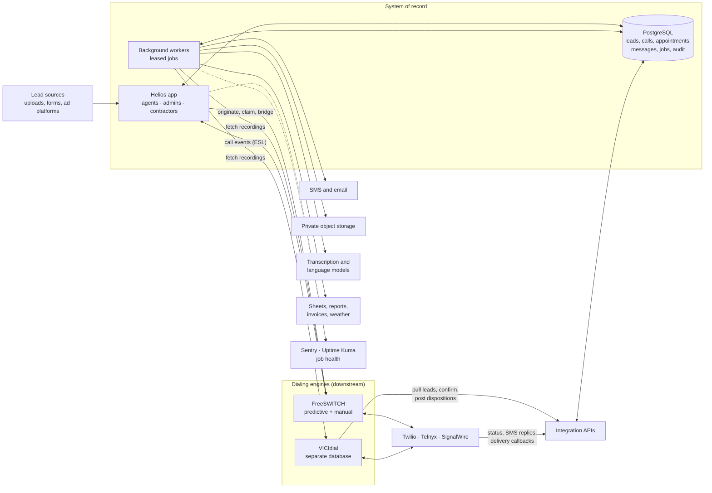

# Helios — full case study

### Keeping one business record true across dialers, carriers, messages, and field crews

*This is the long version. For a one-page summary, see the [README](README.md).*

Helios runs the day-to-day operations of a lead-generation and appointment-setting business that serves home-service contractors, mostly roofing and exterior work. Agents call homeowners, set inspection appointments, and hand them to contractors. Contractors run the appointments and report what happened. The business bills contractors for qualified appointments.

When the work started in March 2026, that chain was spread across a browser dialer, spreadsheets, text messages, and people's memory. Each piece worked. Together they made a simple question hard to answer: **what happened to this lead?** Was it called, by whom, from which number? Did the call produce an appointment? Was the homeowner reminded? Did the contractor show up? Can the business bill for it?

Over the following seven months Helios grew into the system that answers that question. It now connects lead ingestion, two dialing engines, three voice carriers, SMS and email, recordings and transcription, AI-assisted review, contractor workflows, billing, and weather context. Most of the engineering effort did not go into adding those features. It went into one recurring problem:

> **Central question:** how do you keep a lead, a call, an appointment, a message, and a contractor outcome connected when each part may live in a different system, and external providers can retry, delay, or partially fail?

The answer this project arrived at, mostly by learning from production incidents, is a small set of rules: Helios owns the business record; every other system is either a downstream worker or a source of evidence; uncertain outcomes get their own state; and "done" means verified in production, not deployed.

**Focus:** cross-system state ownership · telephony integration · durable background work · reconciliation · applied AI with human review · operational reliability

**Core technologies:** Python, Reflex, FastAPI, PostgreSQL, FreeSWITCH (ESL, Verto/WebRTC), VICIdial, Twilio, Telnyx, SignalWire, AssemblyAI, Anthropic Claude, local LLMs (LM Studio), Stripe, DigitalOcean Spaces, Nginx, systemd, Sentry, Uptime Kuma

**Project stage:** in daily production for the operating business since March 2026. A first external pilot, on its own dedicated stack, was being prepared for late October 2026. Some paths, such as FreeSWITCH predictive dialing, are beta or off by default; see [Current boundaries](#current-boundaries).

**Presentation:** source code, customer data, and infrastructure details remain private. Selected workflows and decisions can be discussed in a guided walkthrough.

## One workflow, several systems

A single appointment touches most of the platform. A lead arrives from an upload, a web form, or an ad platform. It is selected for dialing by Helios's own predictive dialer or delivered to VICIdial. A carrier places the call; FreeSWITCH or VICIdial records it. An agent sets an appointment in Helios. Workers send confirmations and reminders, pull the recording, transcribe it, and ask a model to review it. The contractor reports an outcome in the portal, and that outcome drives billing.

This is a logical overview. Provider choices and enabled workflows vary by deployment.

The diagram matters less than the ownership it implies:

| Record | Owner | Other systems hold |
| --- | --- | --- |
| Lead, eligibility, do-not-call | Helios | VICIdial holds a working copy for dialing |
| Appointment and its status | Helios | VICIdial's `APPT` disposition is evidence that one may exist, never a creator |
| Call record | Helios `call_log` | Carrier and dialer IDs are attached as foreign references |
| Recording | Helios-controlled private storage | Dialer and carrier copies are temporary sources |
| Outbound message | Helios claim row | The provider's message ID and delivery status are evidence |
| Caller-ID inventory | Helios | VICIdial mirrors the published list and owns rotation |

## 1. Lead ownership across two databases

In July 2026 the agents moved from Helios's own predictive dialer to VICIdial, because they were getting better results there. That was a business decision, and it created an engineering one. VICIdial has its own MySQL database and its own idea of which leads exist. Helios still had to own eligibility, do-not-call status, attempt limits, and the final outcome. Two databases now had to agree on **when a lead becomes the dialer's responsibility.**

The first design was a delivery ledger with leases and acknowledgements. It failed in a way that took the dialer off the air. When a call finished, the webhook looked up the *newest* delivery for the lead instead of the *open* one, so the closing update matched zero rows. Two hundred deliveries stayed open forever. The feed paced itself from its own ledger, saw 200 in-flight leads against a target of 200, and stopped requesting new ones. Agents got fewer and fewer calls, and nothing reported an error.

The redesign, which went through three adversarial reviews before shipping, rests on a few rules:

- **VICIdial pulls; Helios never pushes.** A worker on the dialer box measures its own live inventory and asks Helios for more when it runs low. If Helios is down, VICIdial keeps dialing what it already has.
- **Pacing reads observed state, not belief.** The worker counts dialable rows in VICIdial. The delivery ledger is kept for ownership and reconciliation, never for capacity. A ledger can hold unfinished records long after the dialer has moved on; live inventory cannot.
- **Reserve → stage as HOLD → verify → activate.** Helios records ownership before delivery. Rows are inserted into VICIdial in a held state, read back by vendor code to prove they exist, and only then activated, and only the delivery IDs Helios authorizes. Reserving after delivery risked a live row Helios didn't know it owned, which could mean a household called twice. Reserving first risks one idle lead, which is recoverable.
- **"Failed" means proven absent.** An API error response can still have written the row, so failure is established by readback, not by exception type. Absence releases the lead. Ambiguity keeps it owned. Nothing is released on a timer.
- **Every state transition checks its row count.** A zero-row update is a failure, not a success.

The first live cycle confirmed all 100 offered leads with zero failures and zero unknowns. The ledger still needed repair. In August, after a second feed incident, an **11,994-row outcome replay** rebuilt call outcomes from VICIdial's own records, so Helios's history matched what had actually been dialed.

That August incident showed something else. One state's leads had been silent for days. Two causes surfaced: the selection query sorted by ascending lead ID, so the newest upload stayed invisible until every older list drained; and leads with an unmapped ZIP were sent with an empty state, so VICIdial stored a GMT offset of zero. Neither bug produced an error, and neither showed up in the UI.

One sequencing lesson came at a cost: **stop the producer before reconciling the ledger.** Reconciling first restored capacity, and the old, unfixed worker immediately leased 200 more leads that stranded the same way.

**Engineering lesson:** decide who owns a record before it crosses a boundary. Keep "what I believe is in flight" separate from "what the other system actually holds," and pace from the latter.

## 2. From provider APIs to a media server you own

Helios started in March 2026 the simplest way: calls went through Twilio's API and Voice SDK. Twilio created the call, ran the conference, detected answering machines, recorded the audio, and billed by the minute. For one business with a handful of agents that was the right choice. Within two months it had become the constraint, and the biggest reason was cost.

**The API charges for every piece of a call.** An outbound dialer pays for far more than the carrier minute. On Twilio's Programmable Voice, the way Helios used it, each connected minute paid for the call to the homeowner, the agent's browser leg, both conference participants, and the recording. Every *attempt* also paid for answering-machine detection, whether or not anyone picked up. Twilio's lower rates came through volume tiers and committed-use agreements: a minimum monthly spend over a contract period, negotiated with sales. That's a hard commitment for a small business whose call volume changes with lead supply and storm seasons.

**SIP trunking charges for the carrier minute and not much else.** With Twilio's Elastic SIP Trunking, the same carrier sells the outbound minute at a lower list price, with no contract and no channel limits. Everything else (the agent's audio, the conference, the recording, machine detection) runs on a server the business owns, so it adds no per-minute or per-call charges.

At Twilio's published US list prices (August 2026), one connected minute of a dialer call compares like this:

| Component | Programmable Voice (API) | Elastic SIP Trunking + FreeSWITCH |
| --- | --- | --- |
| Outbound minute to the homeowner | $0.0140 | $0.0100 (termination, contiguous US) |
| Agent's browser leg | $0.0040 | — (WebRTC to own server) |
| Conference, two participants | $0.0036 | — (own server) |
| Recording | $0.0025 | — (own server, then private storage) |
| **Per connected minute** | **≈ $0.024** | **$0.010** |
| Answering-machine detection | $0.0075 per attempt | — (own server) |
| Lower rates | Volume tiers or a committed-spend contract | List price with no contract; deeper discounts optional |

That is roughly 2.4 times cheaper per connected minute, before machine detection. Predictive dialing makes the gap wider, because most attempts are unanswered, short, or voicemail: at a thousand attempts a day, machine detection alone costs $7.50 a day on the API path, and nothing on the trunk. The trunk path does add a fixed cost, the FreeSWITCH server and the time to run it, but that doesn't grow with each call. The table uses list prices; the business's own negotiated rates aren't part of this write-up.

The lower price was the main reason for the move. Two engineering problems came with the API path as well.

**Every carrier was a separate code path.** In April, Telnyx was added as a second carrier. That meant a second browser SDK, a second set of webhooks, and a second way to connect an agent to a call. The number warmer, which test-dials numbers to see whether carriers have labelled them spam, had to be reimplemented per provider; its Telnyx version spent a while silently dropping every result. Adding SignalWire would have meant a third copy. Rotating caller IDs and resting flagged numbers is a daily part of outbound calling, and each carrier made it a code change.

**Twilio owned the parts that mattered most.** Answer detection, conference behavior, recording storage, and the billable duration were all Twilio's. When agents reported calls that started silent or dropped on their own, there was little to inspect beyond the vendor's logs.

In May 2026 the calling layer moved behind a self-hosted FreeSWITCH server. The ownership rule was set first: **FreeSWITCH holds no business state.** Numbers, health scores, call records, and outcomes stay in Helios; the app tells FreeSWITCH which caller ID and which carrier to use for each call. Twilio, Telnyx, and SignalWire became SIP trunks behind one dialplan, and the outbound dialplan fails closed if a call arrives without a caller ID that Helios assigned.

What that opened up:

| Capability | On provider APIs | Behind FreeSWITCH |
| --- | --- | --- |
| Changing or adding a carrier | New SDK, webhooks, and UI code | A trunk and a per-number `carrier_trunk` value |
| Agent audio | One browser SDK per carrier | One WebRTC (Verto) connection per agent, a persistent room per shift, agent-only ringback when a carrier sends none |
| Call control | REST calls and webhooks after the fact | A live event stream: park a call, classify it, then decide where it goes |
| Answer detection | The provider's, as a black box | Timing data per call, and voice-based detection that could be tested in shadow mode |
| Failure detail | Provider dashboards | SIP hangup causes stored on every call (no answer, rejected, unallocated number) |
| Recordings | Stored at the provider | Local files moved to private storage the business controls, then transcribed |
| Billing | The provider's invoice | Answered seconds measured by the media server, Helios's own billing basis |
| Inbound | Per-provider webhooks | One DID routing layer: ring-then-escalate, auto-bridge, forwarding groups |

The billing row became a business model. In June 2026 a client signed up to use the dialer, billed per seat and per metered minute. Because every carrier now sat behind the same server, the answered duration FreeSWITCH measured (`billsec`) could be the source of truth, rounded up per minute the way carriers bill. The client sees one blended rate and an exact, auditable minute count. Carrier identity, carrier cost, and margin stay internal, and are excluded from every tenant-scoped query. That arrangement only works when you own the meter.

It also had costs that the provider had been absorbing:

- **A public SIP server gets attacked.** In early June, two waves of toll-fraud INVITEs, 26,955 in one day aimed at international premium numbers, drove the single-core server to 100%. The SIP profile was bound to the public interface with no firewall in front of it and was still on a default password. The intrusion-prevention filter matched only registration failures, so it never banned the flooders. The fix was a cloud firewall that admits only known carrier ranges, plus a hardened fail-closed dialplan.
- **The media server is now your outage.** Building one extra module from source replaced the core FreeSWITCH library and took calling down until it was rebuilt. Later module builds were planned for off-hours with a cold-restart test.
- **Operations add up.** The recording-sync SSH storm (§11), disk and memory sizing, and separate timezone and log locations on the telephony box were all new work.

**Engineering lesson:** a vendor's API bundles the carrier minute with services you may be able to run yourself. Unbundling them cut the cost per connected minute by more than half, with no contract, and it also let the business switch carriers, measure its own minutes, and classify its own calls. The savings are real only if you also take on the security and operations work the vendor had been doing.

## 3. FreeSWITCH predictive calling

The predictive dialer was the last flow to move off Twilio. On FreeSWITCH it was rebuilt as an **answer-gated** dialer: the homeowner's phone rings in isolation, and only after an answer is confirmed and classified is an agent claimed and connected. That shape, which provider APIs made awkward, is what the event stream allows. It runs as its own process with its own event-socket connection, so a fault there cannot stall manual dialing.

A predictive call has a long life, and each stage can fail on its own:

1. **Origination.** A 4-second scheduler tick decides how many lines to dial per available agent. A PostgreSQL advisory lock prevents two processes from double-dialing.
2. **Answer detection.** FreeSWITCH reports the answer over its event socket.
3. **Human or machine.** The call is classified before anyone is connected.
4. **Agent claim.** An available agent is reserved atomically (`FOR UPDATE SKIP LOCKED`).
5. **Bridge.** The caller joins the agent's persistent conference room.
6. **Finalization.** Hangup cause, disposition, attempt count, and retry time are recorded.

The persistent per-agent room came from production bugs. The first design created a new conference for every call, and agents reported silence at the start of calls and calls ending on their own. Giving each agent one stable room per shift, which callers join and leave, removed a whole class of setup races. It also introduced a new failure: two separate allowlists, one in the database deciding who receives calls and one in the environment deciding whose browser opens a room. An agent on the first list but not the second was sent humans with nowhere to land. Each of those bridges dropped a real person. The fix aligned the lists and added a bounded retry: if one agent's room isn't ready, try the next agent, up to four times.

Classification is where the central tradeoff of this dialer sits. **Losing a human is worse than letting some voicemail through.** A voicemail that reaches an agent costs a few seconds; the agent hangs up. A human who is misclassified as a machine is hung up on. That is a lost lead, and to the homeowner it looks like a spam call.

Live data made the tradeoff concrete. In one July window, 13 of 26 bridged calls had under ten seconds of agent talk time: voicemails that got through. All 13 had answered in 1.4–9.2 seconds, the same range as real conversations. No timing threshold could separate them. So voice-based answering-machine detection (`mod_amd`) was compiled, armed in shadow mode, and then enabled as a gate before bridging. Agents reported *fewer* humans the same day: the detector's default tuning was calling short "Hello?"s and quiet lines MACHINE. The gate was rolled back within hours. The code ships dark, in shadow mode, until the false-machine rate has been measured against confirmed human talk time. The timing classifier is deliberately biased toward "human."

Smaller lessons from this path:

- An entire campaign paused with "missing safe-harbor config" because a migration created the table without granting the application role access to it. The table was visible in a database client running as a privileged user and invisible to the service.
- Environment variables read once at import can silently disagree with the systemd unit. The running process's environment is the source of truth.
- A scheduler that returns "no eligible agents" without logging is undiagnosable. A throttled log line at that gate is what made a five-layer outage traceable.

**Engineering lesson:** decide in advance which error you would rather make, and set every threshold, fallback, and rollback to favor it.

## 4. Durable SMS: claim before send

In July 2026 the business's outbound text volume jumped from about 10 a day to over 60. Investigation found **117 duplicate missed-call text-backs**; about two dozen callers had each received the same text five to ten times. One of them replied STOP, which is a permanent opt-out.

The cause was an ordering trap. The worker sent the SMS, then inserted the log row in the same transaction. The provider accepted the message, but the insert failed a database check constraint. The transaction rolled back, the job failed, and the job queue retried it. The duplicate guard looked for the log row, which had been rolled back, and found nothing. So it sent again, up to the job's maximum attempts. Querying the message log made it worse: the table *under-counted* exactly when the bug fired, so it seemed to disprove the right hypothesis. The provider's own message list was the only reliable record.

The fix changed the order of operations for every outbound path:

- **Claim before send.** A row is committed before any provider call, carrying an immutable **dedupe key** built from the service, the job, and the recipient (for example, one text-back per missed call). A partial unique index makes the claim atomic across workers, cron, and reclaimed leases.
- **A timeout is unknown, not failed.** If the provider call times out, the claim stays as `outcome_unknown`. It is not resent automatically, because the provider may already have delivered it. A person reconciles it.
- **`sent_at` is set only after the provider accepts.** Delivery callbacks update the record as more information arrives.
- **Dry runs write nothing.** A dry run that left a pending claim had once suppressed a real text for 24 hours.

The later outreach module, for bulk drip campaigns to purchased lists, was built on the same claim. It adds contact-local send windows (no message before 9 a.m. in the recipient's time zone), a typed attestation for each batch, separate sending numbers with per-number caps, and one shared do-not-contact writer: a STOP on any number, or a do-not-call request on a call, blocks both SMS and voice. Replies land in a human inbox; uncertain ones are never auto-answered.

**Engineering lesson:** never write *send → log → commit*. Commit the intent first, give it a key that can't repeat, and treat an ambiguous provider outcome as its own state.

## 5. The appointment lifecycle

An appointment moves through creation, contractor assignment, same-day confirmation, an evening reminder, a morning text, an hour-before check, possible reschedule or cancellation requests, the contractor's outcome, and billing. Each step reads the appointment's status, and for months that status was free text.

The agent form took the status from an editable dropdown, so its spelling and capitalization were whatever the dropdown's seed data held. In June 2026 the morning text silently skipped a real appointment because its status was `New appointment` instead of `New Appointment`. An audit found **33 code paths** comparing status strings exactly, and about **465 rows, roughly 18% of the table**, that no status filter could match: casing drift, spelling variants (`Bad Lead - Canceled` vs `Bad Lead - Canceled by Client`), and legacy imports with no status at all. The blast radius covered SMS, invoicing, the transcription gate, call routing, reports, and the contractor portal. The same audit found a trial-to-invoice promotion that had never fired, because it compared a numeric display code to a text label.

The fix had three layers: a single `canonical_status()` helper at every write site, normalized comparisons at every read site, and a database trigger that canonicalizes on insert or update, backed by a seed table that a test keeps in sync with the code. The value-drift backfill was run by the business owner after they reviewed the mapping. One group of 71 rows is still unmapped, because which party "Lead Company" refers to is a business question, not a code question.

The same class of problem showed up wherever a mutable text field stood in for an identity:

- **Calls to appointments.** VICIdial's `APPT` disposition says an appointment *may* exist; it never creates one. Matching originally relied on phone number and time window, which is ambiguous when a household calls back. Automatic attachment ships off. A *Needs reconciliation* picker lets people confirm matches, and every attachment is written to an audit table. Leads delivered through the new feed now carry stable `lead_id` and delivery IDs, so the exact relationship is recorded at creation and no guesswork is needed.
- **Agents across systems.** VICIdial usernames and Helios agent IDs are separate, mutable identities. A mapping table assigns call ownership; agent identity never decides a match.
- **Join keys in notes.** Early integrations stored the dialer's call ID inside a free-text notes field. A real column replaced it, but three workers still parse the old marker, so its format is load-bearing until they migrate.

The audit trail mattered for its own reasons. In July, an admin's *Update Appointment* action turned out never to have worked, in 13 days of attempts. Its audit-log insert used a field name the table's check constraint did not allow. The audit insert and the appointment update shared a transaction, so the reschedule was rolled back too, and a bare `except` turned that into a generic "please try again" toast with nothing in the logs.

**Engineering lesson:** a status or identity that a person can edit is a label, not a key. Give business states one canonical form enforced in the database, and join records on identifiers that never change.

## 6. Recordings and transcription

A useful call record needs more than an audio file. The carrier callback, the dialer's call ID, the media file, storage, playback, transcription, and review all have to agree on one conversation.

The pipeline today:

- FreeSWITCH and VICIdial record locally. Background jobs fetch each file, convert it, and upload it to **private object storage**. The local copy is deleted only after the full fetch, convert, upload, and update chain succeeds.
- Playback goes through an authorization check and a **short-lived signed URL**. Recordings are never public links.
- **AssemblyAI** transcribes with speaker labels. It replaced Whisper in June 2026 because it separates the agent from the homeowner. Call review needs to know who said what, and Whisper's transcripts didn't label speakers.
- The diarized transcript feeds **AI call review**, which flags calls for a person to check (see [§10](#10-applied-ai-narrow-roles-human-paths)).
- Permanent failures, such as an authentication error or missing storage config, are marked terminal. A not-yet-ready file stays retryable.

The design principle came from recovery work: **an unmatched recording is still evidence.** When a recording can't yet be tied to a call, its source is kept until ownership is resolved, rather than being discarded as an orphan.

The pipeline also caused the project's most instructive infrastructure incident; see [§11](#11-operational-incidents-and-what-they-taught).

**Engineering lesson:** keep recoverable intermediate states, and never delete the source until the destination is confirmed.

## 7. Background jobs: process health is not outcome health

Reminders, digests, invoices, transcription, recording sync, sheet sync, weather, and reports all run outside a browser request. Starting in June 2026 they moved from loose cron scripts to a shared PostgreSQL-backed job table with **leases** (a worker owns a job for a bounded time), **retries** with attempt limits, **terminal states** for permanent failures, and dead-letter inspection. Jobs are keyed by business identity: an appointment, a recipient, a recording, a contractor and billing period. Several scripts keep a direct execution path for controlled recovery.

The job table made work inspectable, and it also showed what the monitoring couldn't see. In two days at the end of July, three independent multi-week silent outages turned up:

| Job | What happened | Silent for |
| --- | --- | --- |
| Daily appointment digest | Cron ran the system Python instead of the project's virtual environment. The script crashed on its first import, before its own alerting code could run. | About 16 weeks |
| External sheet sync | The job was never in the active crontab; an orphaned copy elsewhere failed on file permissions. | About 14 days |
| Contractor sheet sync | Cron passed a stale database password. | Weeks |

The job-failure alerts watched job rows for errors. A job that is never enqueued creates no row, so it can't fail. An earlier "fix" to the digest had rotated an email password, which was real but irrelevant: cron never got far enough to use it.

The digest also showed a quieter failure: its default mode enqueued jobs that **no worker handled**. The rows sat there and nothing was sent. Elsewhere the same pattern appeared as zero-row updates reported as success: a payment webhook returned `ok` when its update matched no invoice, and the VICIdial feed's delivery-close update matched nothing for two hundred calls. In each case the process was healthy and the business outcome was wrong.

**Engineering lesson:** monitor for expected success, not just for errors. The ground truth is the outcome table: an email log, a sync watermark, a delivered message. An empty outcome table means "never attempted," which is a different bug from "attempted and failed."

## 8. Large lead import: bounded work

In June 2026 an operator imported a file of about **177,000 leads** through the desktop upload tool. PostgreSQL ran out of shared memory, the Linux OOM killer terminated the database, and the whole platform went down until it was restarted.

The importer held the entire file in one transaction, created a savepoint per row without releasing it, and inserted rows one at a time. Lock memory grew with file size, and the only commit came at the end. The UI's progress message saying rows "were committed" was not true.

The redesign bounded every dimension of the work:

- **Streaming input.** CSV and Excel files are streamed; only a 5,000-row preview stays in memory.
- **Bounded commits.** Bulk inserts in batches of 1,000, each committed separately.
- **Bad-row isolation.** A batch the database rejects is split recursively until the bad row is found; an operational or connection error aborts the import instead of being counted as bad data.
- **Disk-backed failure reports.** Invalid and duplicate rows are written to a file as they occur, not accumulated in memory.
- **Checkpoints and resume.** A checkpoint keyed to the file, column mapping, and target list lets a relaunch continue after the last committed row, into the same list.
- **Honest progress.** The UI distinguishes rows read from leads committed, and cancellation keeps completed batches.

No database setting had to change. The database was right to refuse; the importer was asking for unbounded work.

**Engineering lesson:** every loop over external input needs a bound on memory, locks, and time, and a place to resume from. "It worked on a small file" says nothing about the large one.

## 9. Schema drift and canonical business states

Helios grew quickly, with a mix of ORM models and raw SQL, and its schema changes were applied by hand. By July 2026 a review flagged "schema drift and hidden coupling" as a launch blocker, and production kept proving it right. One failure pattern repeated in at least four features: **code wrote a value the database's check constraint didn't allow, and a broad exception handler hid it.**

- The duplicate-SMS loop (§4) began with a message type the constraint didn't list.
- The VICIdial do-not-call path had **never worked in production**. It wrote a source value outside the constraint, so every do-not-call disposition rolled back the entire webhook transaction, including the call record. Pilot testing had only used other dispositions.
- The appointment update (§5) failed on an audit field name for 13 days.
- The predictive campaigns paused over a missing table grant (§3).

The response was infrastructure, not just fixes:

- **A migration ledger.** New migrations are dated files applied by a runner that records each one with a checksum. About 78 historical hand-applied files were backfilled into the ledger.
- **Schema snapshots.** A checked-in snapshot of the live schema covers tables, columns, indexes, foreign keys, check-constraint definitions, triggers, and **grants**. A `--check` mode exits non-zero on drift. Its first run found **100 live tables against 78 documented**.
- **Constraint-aware review.** Any literal value a writer inserts is checked against the snapshot's allowlist before the code ships. The snapshot, not the hand-written schema doc, is the ground truth.
- **Errors surface.** Silent `except` blocks around database writes now log and report to Sentry.
- **Canonical identities.** Stable foreign keys (`lead_id`, delivery IDs, appointment IDs on calls) replace joins on phone numbers, names, and text markers.

**Engineering lesson:** representational drift (two spellings of one state, one value the code knows but the database doesn't) is an operational failure, not a cosmetic one. Put the canonical form in the database and make drift detectable by a command.

## 10. Applied AI: narrow roles, human paths

Helios uses language models in several narrow roles rather than as one autonomous agent. Each role has a bounded input, a structured output, and a defined, limited effect on the business record.

| Role | Model input | Effect |
| --- | --- | --- |
| Appointment notes review | Notes written when an appointment is submitted | Flags notes that need attention; agents and admins filter on the flag |
| Call review | Speaker-labelled transcript | Rates the call Good, Review, or Urgent against qualification and misrepresentation criteria |
| Appointment SMS replies | A homeowner's or contractor's reply with the matched appointment | Classifies intent with a confidence score; reschedule and cancel requests go to a team-chat approval with Approve/Deny buttons |
| Outreach reply classification | A reply to an outreach message | One of eight categories with confidence; interested contacts are flagged for the human inbox; no automatic replies |
| Reporting | Aggregated funnel and call metrics | Short narrative insights for contractors and number-health recommendations |
| Lead research | Public excerpts from business websites | A local model classifies businesses and proposes contacts backed by quoted evidence |

The same rules apply to every role:

- **Deterministic rules come first.** Opt-out keywords are handled before any model is called. Configurable keyword rules handle common replies without one.
- **Structured output with confidence.** Low confidence, or output that doesn't parse, routes to a person. No automatic action is taken on a guess.
- **Errors are asymmetric by design.** Opt-out-like replies are treated as do-not-contact. An appointment's call-review flag only escalates; the worst reviewed call wins.
- **AI never blocks the core workflow.** If the model call fails or times out, the appointment is still saved and its flag stays pending. Reports fall back to template text.
- **Decisions are reviewable.** Prompts are editable without a deploy. Each classification stores the prompt, raw response, confidence, and model version. Operator corrections are kept as labels.
- **The model is a setting.** One value selects the model everywhere. A read-only replay tool runs past messages through a candidate model and compares results with stored labels without sending anything.
- **Extracted facts stay unverified.** Lead research accepts a proposed contact name only with an exact quote from the fetched page, and ownership is never inferred from a job title. A [standalone version of the classifier](https://github.com/daniellopezq/local-business-classifier) is public.

The replay tool also exposed a limit: without deterministic sampling, the same message could get a different label on a second run. In the recorded case the routing was the same. Deterministic settings are a recorded follow-up. Model output is a triage aid; it doesn't decide compliance, call quality, or anyone's identity.

**Engineering lesson:** give a model a narrow decision and a way to say it's unsure, and give everything it's unsure about a human path.

## 11. Operational incidents and what they taught

Several incidents above shaped the architecture directly. A few more shaped how the system is run.

**Recording-sync SSH storm (June 2026).** The FreeSWITCH server, a single-core machine, climbed from 15% CPU to a pinned 100% over 36 hours, with a load average of 123. FreeSWITCH itself was idle. The recording-sync cron started every five minutes with no lock, each run took longer than five minutes, and the copies stacked up. Each copy opened **one SSH connection per file**. Every login forked a session and ran login scripts, and the flood of auth log lines kept the intrusion-prevention daemon busy parsing. Because files were deleted only after a successful run, the backlog grew, and the storm grew with it. The fix: a single-instance lock, one reused SSH connection per run, and a per-run cap. *Lesson: a monotonic ramp that never recovers means unbounded accumulation, not one runaway process; any job that can outlast its interval needs a lock.*

**Wrong interpreter in cron (found July 2026).** Described in §7. The documented crontab line had been corrected in the notes but never installed, and the documented log path was wrong too, so tailing it looked like "never ran." *Lesson: read the scheduler and its log path from the live system, not from documentation; anything that must survive an import error has to live outside the script.*

**Duplicate SMS retry loop (July 2026).** Described in §4. A post-rollout review found the two services where the incident started had been left on the weaker pattern. *Lesson: when a fix introduces a pattern, audit every sibling, starting with the original offenders.*

**Production source loss (September 2026).** Twenty-three source files that had never been committed disappeared from the live server. Tracked files were untouched. Twenty-two were restored from a server backup with their original timestamps; the missing one was unreferenced. The cause was never fully proven. Months of work had existed only as untracked files on one filesystem. The response became the first workstream of the pilot plan: everything committed and pushed in themed chunks, `main` re-baselined and tagged, CI added, nightly database backups to object storage, and a documented restore test into a scratch database. *Lesson: work that exists in one place is not saved, however long it has been running in production.*

**Dashboard outage without errors (October 2026).** The site timed out with nothing in the service logs. The 2 GB server was thrashing swap: about 25 idle Python services sat in swap while the app backend grew to over 600 MB in 35 hours. The server was resized, and backend memory is now logged hourly to see whether the growth is steady. The uptime monitor *had* seen 85 failed checks; it just had no alert channel attached. *Lesson: a monitor without a delivery path is a log file. Test the alert, not only the check.*

## 12. Observability and operational acceptance

The monitoring stack is ordinary: **Sentry** for exceptions, **Uptime Kuma** for HTTP, keyword, and push monitors with Slack and SMS alerts, a **job-health** view over the job table (stale leases, retry counts, dead letters), and **queue-lag** checks. The incidents above showed what that stack can't see on its own, so the project added business-outcome checks:

- Daily job outcomes are compared with expectations (digests sent, sheets synced, outcomes replayed).
- Message claims stuck in `pending` or `outcome_unknown` are surfaced for reconciliation.
- VICIdial delivery states are watched for `queued` climbing while `completed` stays flat, the exact signature of the earlier ledger bug.
- A backend health endpoint is monitored directly, because the public `/ping` route was answered by the static front end and said nothing about the backend.

The project also stopped using "done" as a single word. Engineering notes record four separate milestones:

| Milestone | What it proves |
| --- | --- |
| Code written | The change exists, possibly only on one disk |
| Tests passing | The change behaves as its author expected in isolation |
| Service restarted | The change compiles and boots against real configuration |
| Production verified | The business outcome happened: a call bridged, a text was delivered once, a row reached `completed` |

Several fixes in this README spent days between the third and fourth milestones, and some changes that passed the first three were rolled back at the fourth.

**Engineering lesson:** test the boundary you changed, and keep enough evidence to say exactly which of these milestones a change has reached.

## How the project evolved

Each phase was driven by a business need first, and each left behind an engineering problem that shaped the next phase.

| Period | Business driver | Engineering focus |
| --- | --- | --- |
| March 2026 | Replace a browser dialer, spreadsheets, and memory with one place to set, review, and bill appointments | Twilio browser dialer, callbacks, call logging, appointments, contractor portal, invoicing, territories, Google sign-in, supervisor listening, first AI review of appointment notes |
| April 2026 | More calling capacity and a way to sell the service to new contractors | Telnyx WebRTC calling, recording, prospect CRM and webhooks, SMS reply classification with team-chat approval, Sentry and Uptime Kuma, early `org_id` groundwork |
| May 2026 | Per-minute API cost (about 2.4× the SIP trunk rate, with discounts only through committed spend), every carrier a separate code path, and agents reporting dropped and silent calls | FreeSWITCH migration with carriers as SIP trunks, persistent per-agent rooms, answer-gated predictive dialing, multi-carrier number buying and warming, Spanish-language lead routing |
| June 2026 | A first dialer client billed per seat and per minute; larger lead lists and more automation | Metered billing from FreeSWITCH answered seconds, toll-fraud floods and a carrier-only firewall, recording-sync storm and fix, 177k-import OOM and streaming importer, AssemblyAI with speaker labels, AI call review, the move to a durable job queue, status-drift audit |
| July 2026 | Agents got better results on VICIdial, so Helios became the system of record around it | VICIdial webhook, recording ingestion, call-to-appointment reconciliation, dynamic feed with reservations; claim-before-send SMS; migration ledger and schema snapshots; AMD gate tried and rolled back; embedded Stripe checkout; silent-cron discoveries |
| August 2026 | Keep VICIdial dialing the right leads from the right numbers | Caller-ID pool mirrored to VICIdial, the dark-state incident, outcome replay, feed worker recovery |
| September 2026 | A second channel: bulk SMS outreach, plus inbound call forwarding | Source-loss recovery, SMS outreach module (separate number pool, drip worker, attestation, inbox, reply classification), call-forwarding groups |
| October 2026 | An external pilot customer, and contractor disputes over weather | Code-safety baseline (commit, CI, backups, restore test), pilot stack design with VICIdial behind a Helios agent screen, per-appointment weather snapshots and a storm archive, memory-pressure outage and monitoring fixes |

Each period summarizes dated commits and engineering notes. Individual features have different implementation, test, and deployment histories.

Three turns in that history are worth calling out. In May, calling moved from Twilio's API to SIP trunks behind a media server the business controls. That cut the cost of each connected minute by more than half without a contract, made carriers interchangeable, and made it possible to sell metered dialer minutes. In July the business chose VICIdial over the in-house predictive dialer because agents connected with more people there. Rather than compete with VICIdial, Helios was rebuilt around owning what VICIdial doesn't: eligibility, do-not-call, outcomes, appointments, and money. In October the pilot decision went the same way: a **dedicated stack per customer** instead of shared multi-tenancy, because tenant isolation in the shared database had not been proven, and a cross-customer data leak would cost far more than an extra server.

The weather work shows the same ownership thinking on a small scale. Contractors sometimes cancel because of weather, and weeks later the business needs to know whether that was reasonable. Helios captures a forecast snapshot when an appointment is set or rescheduled, the night before, the morning of, and about an hour before, with source and capture time. Providers fall back from a primary service to the National Weather Service to the last stored snapshot, under a per-SKU free-tier budget. Weather never blocks a reminder. A reading is context for a place and time; it doesn't prove conditions at a specific roof.

## What this project demonstrates

Helios is a product built where distributed-systems problems meet a real business: callbacks that arrive late or twice, providers that time out after succeeding, two databases that each think they're right, and records keyed on text a person can edit. The useful result is not the feature list. It is a set of rules that kept appearing and have now been applied deliberately:

- One system owns each business record; the rest are workers or evidence.
- Uncertain outcomes get their own state, and a person resolves them.
- Reconciliation starts from evidence (provider records, dialer rows, outcome tables), not from what the application believes.
- Work is bounded, leased, and resumable.
- Canonical states and identities live in the database, and drift is detectable by a command.
- AI makes narrow, reviewable suggestions and never blocks the core workflow.
- "Done" means verified in production.

It also shows the less visible work that keeps a production system honest: dated incident write-ups that record wrong diagnoses along with right ones, adversarial reviews before risky deploys, rollbacks taken the same day, and documentation that separates code written from behavior verified.

## Current boundaries

This README describes a system in active development, and some parts are stronger than others.

- **Deployment scope.** Helios runs one operating business in production. The first external pilot runs on its own dedicated stack. It is not yet a self-serve, multi-tenant SaaS product.
- **Multi-tenancy.** An `org_id` exists on most business tables, but an October audit found about 137 queries that don't filter on it, and some credentials are still global. Tenant isolation in a shared database is groundwork, not a proven guarantee. That is why the pilot uses a dedicated stack.
- **Predictive dialing.** The FreeSWITCH predictive path works and was used in production, but it is beta and outside the pilot release. Voice-based machine detection runs in shadow mode only, pending calibration.
- **Uneven verification.** Message claiming, the VICIdial feed's ownership chain, and lead import have strong production evidence. Some newer paths, such as parts of the weather rollout and the outreach inbox checklist, were deployed with follow-up verification still open at the time of writing.
- **Reconciliation backlog.** Some historical VICIdial deliveries remain unsettled, and a few business-state mappings are waiting on business decisions rather than code.
- **Operations discipline.** Commits, CI, backups, and restore tests are in place, but they are recent. Deployment still involves manual steps on a live server, and the runbooks are still catching up with the system.

## What I would improve next

- **Prove tenant isolation.** Enforce `org_id` at the query layer (or with PostgreSQL row-level security) and test it adversarially before any shared-database tenant.
- **Staleness monitoring as a first-class check.** For every expected job type, alert when its last *successful* outcome is older than a threshold. One query would have caught all three silent cron outages on the first day.
- **Finish the identity migration.** Retire the remaining joins on phone numbers and note markers in favor of stable IDs end to end.
- **Calibrate machine detection with data.** Measure the false-machine rate in shadow mode against confirmed human talk time before any gate goes live again.
- **Staging that matches production.** A staging stack with real telephony paths, so restarts and migrations are rehearsed instead of first tried on the live server.
- **Smaller application state.** The web app's per-session state has grown large enough to affect memory; splitting it is the likely fix for the backend growth seen in October.

---

*Prepared from the project's commit history and dated engineering notes. Historical production checks are attributed to those records; this document is not a fresh production audit. Customer data, credentials, infrastructure identifiers, internal runbooks, and source code are omitted.*
