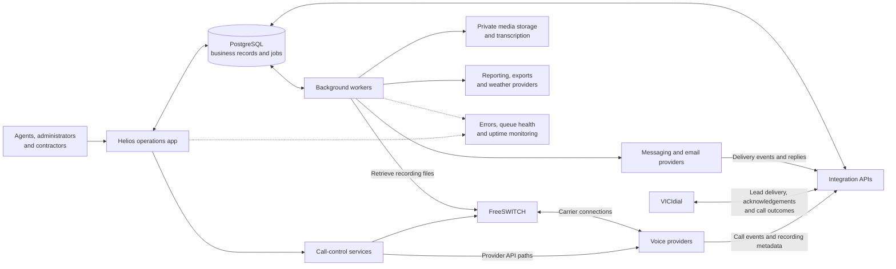

# Helios — Operations, connected.

### Building the connections between leads, conversations, and appointments

Helios is an operations platform for home-service teams. It connects lead intake, agent calling, appointment scheduling, contractor follow-up, messaging, and reporting.

An appointment is the visible result of a longer chain. A lead needs an owner. A call needs an outcome. A recording needs to stay associated with the right conversation. A reminder needs to reach the intended person, even when a provider is slow or a worker restarts.

The engineering story of Helios is how those connections became explicit: through persistent identities, durable work queues, reconciliation, and increasingly useful operational feedback.

**Focus:** application engineering · telephony integration · asynchronous workflows · operational reliability

**Core technologies:** Python, Reflex, FastAPI, PostgreSQL, FreeSWITCH, VICIdial

**Project stage:** an operational system evolving toward a broader SaaS offering

**Presentation:** source code remains private; selected workflows and engineering decisions can be discussed in a guided walkthrough.

## One workflow, several systems

Agents work leads and record call outcomes. Administrators review appointments and coordinate operations. Contractors manage assignments and follow-up. Background services connect these actions to communications, recordings, external systems, and reports.

This is a logical overview. Provider choices and enabled workflows vary by deployment.

## 1. Give cross-system work a durable identity

Connecting a CRM to a dialer raises a deceptively difficult question: when does a lead become the dialer's responsibility?

If a remote insert succeeds but its acknowledgement is lost, retrying can create duplicate work. If the application releases ownership too early, the same lead can become available to another caller.

The VICIdial integration addresses this with reservations and explicit delivery state. A worker pulls eligible leads from Helios, inserts them into the dialer in a held state, verifies the remote record, and activates them after confirmation. Call outcomes return through callbacks and reconciliation.

The distinction between a delivery ledger and live dialer inventory also matters. A ledger can retain unfinished records even when the dialer has moved on. The feed design therefore uses observed remote inventory for pacing and keeps ownership records for reconciliation.

**Engineering lesson:** define ownership before delivery, and design recovery for the point where two systems disagree.

## 2. Make scheduled work visible and recoverable

Appointment reminders, email digests, exports, invoice generation, transcription, and recording synchronization all need to happen outside a browser request.

Helios progressively moved recurring workflows into a shared PostgreSQL-backed job system. Scheduled scripts enqueue work; workers process it using identifiers appropriate to the task, such as an appointment, recipient, recording, or contractor and billing period. Several workflows retain a direct execution path for controlled recovery.

This introduced an operational distinction: a scheduler can be present while the intended work never reaches the queue. A worker can complete a job while the external outcome still needs confirmation. Health checks therefore need to account for stale work and expected recent success, as well as exceptions.

**Engineering lesson:** persistence makes work inspectable; useful monitoring checks whether the workflow is making progress.

## 3. Treat uncertain message outcomes explicitly

An external messaging request can time out after the provider accepted it. Automatically retrying that request risks sending the same message again.

The outreach implementation records a send claim before contacting the provider and represents uncertain outcomes explicitly. Eligibility is shared across audience selection and the send-time recheck. Delivery callbacks update the record as more information arrives.

The surrounding workflow includes consent records, opt-out handling, contact-local sending windows, sender capacity, and a human inbox. Inbound classification helps organize replies while preserving a human response workflow.

These are engineering controls within the application; they are not a claim of legal certification or a guarantee of message delivery.

**Engineering lesson:** uncertainty deserves its own state. Recovery should account for what the provider may already have done.

## 4. Preserve the connection between a call and its recording

A useful call record involves more than a completed audio file. Provider callbacks, call identifiers, media synchronization, storage, playback, and transcription must agree about the same conversation.

The engineering records describe that pipeline evolving through callback correlation, private object storage, signed playback access, and background transcription. Recovery work also exposed a broader principle: an unmatched recording may still be valuable evidence. Its source should be preserved while ownership is resolved.

**Engineering lesson:** stable identifiers and recoverable intermediate states are essential when a user-facing feature spans several services.

## 5. Add field context without delaying the core workflow

The October weather work extends appointment records with weather snapshots and a storm archive. Its design captures context at meaningful points in the appointment lifecycle and retains the source and capture time.

The provider chain supports fallback from a primary weather service to a secondary source and then to a labelled stored snapshot. Quota controls prioritize later appointment checks. Weather enrichment is designed to fail without blocking an SMS or email.

A weather observation remains a reading for a particular place and time. A nearby station reading or forecast provides context; it does not conclusively establish conditions at an individual property.

The October 19 engineering note reports an initial production backfill and live checks. Follow-up deployment steps remained unconfirmed at the time of that record. This newer work is documented separately from the repository snapshot used to prepare this case study.

**Engineering lesson:** enrichment should retain provenance, communicate freshness, and degrade gracefully.

## 6. Make operational changes testable

Telephony and background processing introduced failure modes that basic syntax checks could not reveal: behavior after a cold restart, mismatches between deployed configuration and source, and callbacks that arrive after the initiating request has finished.

The project records describe staged canaries, real call-path checks, rollback decisions, migration tracking, schema comparisons, and later restore testing. Changes that failed their operational checks were sometimes reverted while the underlying behavior was investigated.

This history also changed how progress was described. Code written, tests passing, a service restarted, and a workflow verified in production are separate milestones.

**Engineering lesson:** test the boundary being changed, and retain enough evidence to explain what was actually verified.

## How the project evolved

| Period | Engineering focus |
| --- | --- |
| March–April 2026 | Agent and contractor workflows, appointment history, sign-in, recording and transcription, prospect intake, and provider integration. |
| May–June 2026 | FreeSWITCH calling, staged telephony changes, recording recovery, lead import improvements, and early background-job migrations. |
| July–August 2026 | Durable recurring work, schema guardrails, VICIdial lead delivery, outcome reconciliation, and caller-ID inventory synchronization. |
| September–October 2026 | SMS outreach and operator inbox workflows, repository recovery practices, pilot preparation, and appointment weather history. |

The periods summarize dated engineering records. Individual features have different implementation, test, and deployment histories.

## What this project demonstrates

Helios brings product workflows into contact with the realities of distributed systems: delayed callbacks, partial failures, duplicated work, inconsistent historical data, and changing operational requirements.

The useful result is a set of connected capabilities with increasingly explicit ownership and recovery behavior. The design decisions can be examined through a lead's journey into a call, an appointment's transition into contractor follow-up, or a message's path from eligibility to a provider outcome.

The next stage is to extend those practices as the product evolves: stronger verification across organizational boundaries, clearer worker responsibilities, and repeatable deployment evidence. The case study describes project work and recorded decisions; personal contribution and implementation details can be covered during a guided walkthrough.

---

*Prepared from a review of the project's engineering notes and selected repository paths. Historical production checks are attributed to those records; this document is not a fresh production audit. Internal runbooks, customer data, infrastructure identifiers, and source code are omitted.*
