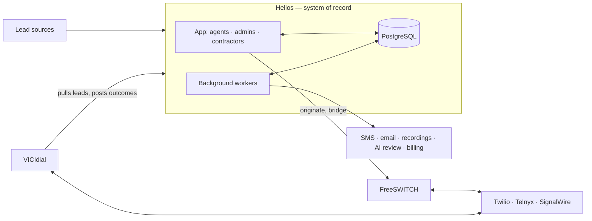

# Helios — Operations, connected.

**The production platform behind a lead-generation and appointment-setting business for home-service contractors.** Agents call homeowners, set inspection appointments, and hand them to contractors; contractors report what happened; the business bills for qualified appointments.

In March 2026 that chain lived in a browser dialer, spreadsheets, text messages and people's memory. Nobody could easily answer **"what happened to this lead?"** Helios is the system that answers it. It has run the business every day since March 2026.

`Python` · `PostgreSQL` · `FreeSWITCH` · `VICIdial` · `Twilio / Telnyx / SignalWire` · `FastAPI` · `Reflex` · `AssemblyAI` · `Claude / local LLMs` · `Stripe` · `systemd`

## Results

- **Cut cost per connected minute by about 2.4×** (≈ $0.024 → $0.010 at list prices, no contract) by moving calls from Twilio's API to SIP trunks behind a self-hosted FreeSWITCH server.
- **Turned that meter into revenue:** a dialer client billed per seat and per metered minute since June 2026.
- **Three carriers behind one dialplan.** Switching carriers is a config value, not a code change.
- **No more duplicate texts:** after a retry bug sent 117, every outbound message is claimed before it's sent, so a retry can't text a homeowner twice.
- **Bounded imports:** a 177,000-lead file that crashed the database led to a streaming importer with batched commits and resume.
- **In production with real users:** agents, admins and contractors have run the business on it daily since March 2026.
- **Opening to outside companies:** an external pilot starts late October 2026, each company on its own dedicated stack.

## How it fits together

The rule behind the design: **Helios owns every business record** (leads, calls, appointments, messages, money). Dialers and carriers are workers or sources of evidence, never the owner.

## Three problems worth talking about

**1. Owning the phone bill.** Twilio's API charged for every piece of a call: the carrier minute, the agent's browser leg, the conference, the recording, and machine detection on every attempt. Moving to SIP trunks plus FreeSWITCH kept only the carrier minute variable. It also made Helios the meter, so answered seconds measured by our own server became the billing basis for the dialer client. The cost: a public SIP server got hit with **26,955 toll-fraud attempts in one day**, fixed with a carrier-only firewall and a dialplan that fails closed.

**2. Two databases, one truth.** When agents moved to VICIdial, two databases had to agree on which leads the dialer owned. The first design paced itself from its own ledger; a bug left 200 deliveries "open" forever, and the dialer quietly ran dry with no error anywhere. The redesign has VICIdial **pull** leads, paces from what VICIdial actually holds, and stages each row on hold, reads it back, then activates it. The first live cycle confirmed **100 of 100 leads, zero failures**, and an **11,994-row replay** rebuilt history from VICIdial's own records.

**3. Never text twice.** A worker sent an SMS, then failed to save the log row; the retry found no log and sent again. **117 duplicates** went out before it was caught. Now every message is **claimed in the database before the provider call**, with a key that can't repeat, and a timeout is recorded as *unknown*, for a person to check, never resent automatically.

## How AI is used

Models do narrow jobs: reviewing call transcripts, classifying SMS replies, flagging appointment notes, researching leads. Each returns a structured answer with a confidence score. Plain rules run first (opt-outs never reach a model), low confidence goes to a person, and a model failure never blocks saving an appointment.

## What it isn't (yet)

- Production today is one operating business with real users; outside companies join through the pilot, each on its own stack. **Not** a multi-tenant SaaS: tenant isolation in a shared database isn't proven, which is why the pilot is separate.
- The in-house predictive dialer works but is beta; voice-based machine detection runs in shadow mode only.
- CI, backups and restore tests exist but are recent.

## More detail

The **[full case study](CASE-STUDY.md)** covers twelve engineering problems in depth, the production incidents behind them, and what I'd improve next.

Source code, customer data and infrastructure details stay private. I'm happy to walk through any part of it live.
